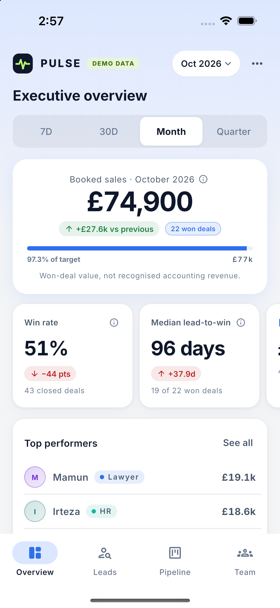
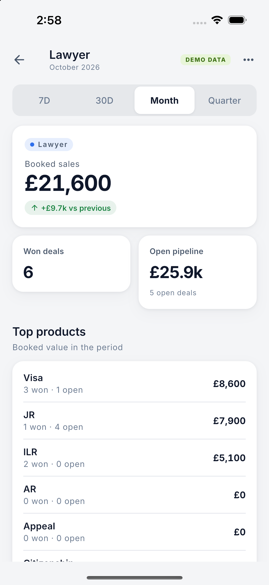
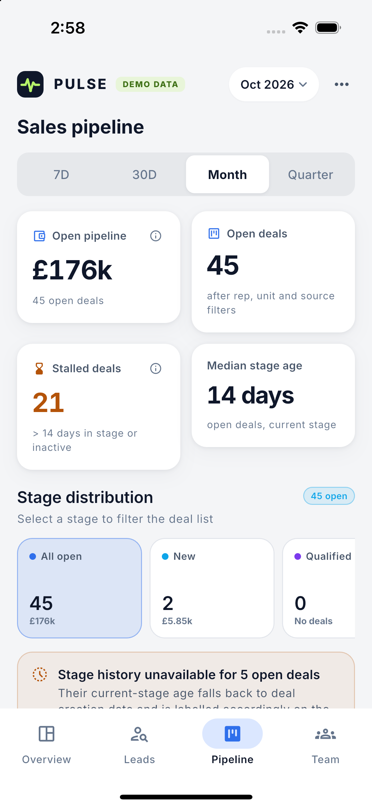
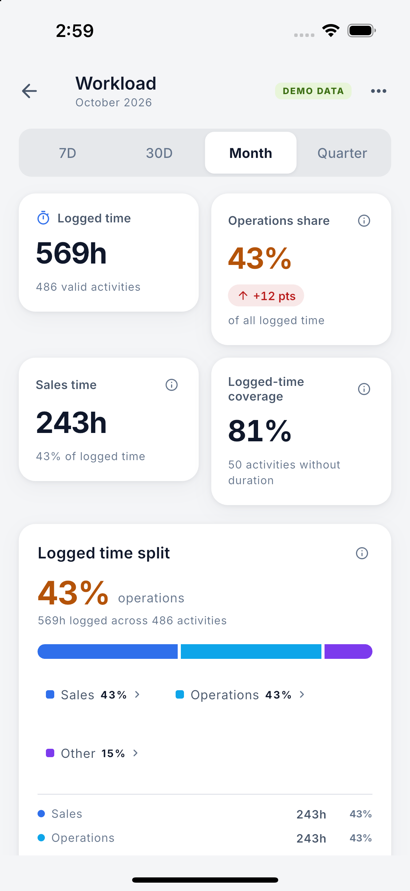
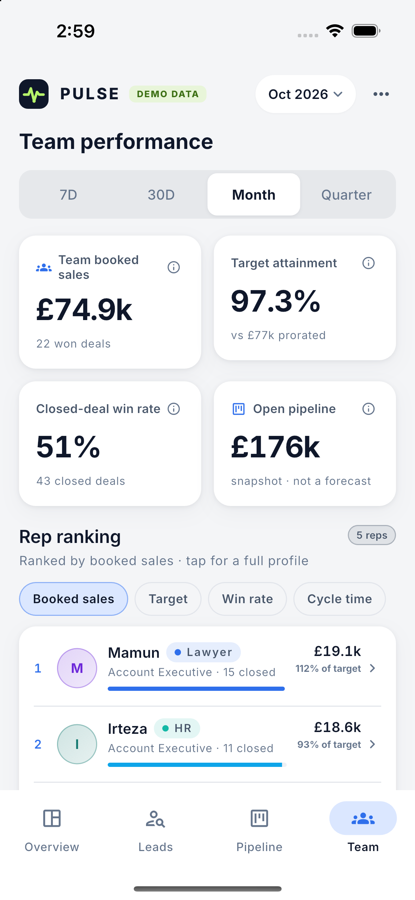

# PULSE: Sales Command Centre

PULSE is an offline Flutter demo of a mobile sales command centre. It turns CRM-style records into a picture leaders can read quickly: what is selling, how fast leads convert, where deals stall, and how much logged selling time goes on operational work.

> **This app shows synthetic sample data only.** It is not connected to monday.com or any CRM. The salespeople's names and the five business units are real, but every figure is invented. Every screen carries a `DEMO DATA` badge and a fixed as-of date (31 Oct 2026, Europe/London). No figure in the app is real company performance.

<p>
  
  
  
  
  
</p>

The product spec is [PULSE_Sales_Command_Centre_PRD_Technical_Spec_v1.0.md](PULSE_Sales_Command_Centre_PRD_Technical_Spec_v1.0.md).

## Setup

Requires Flutter stable (built and tested with 3.47.9; Android target API 36 (Android 16)).

```bash
flutter pub get
dart run build_runner build --delete-conflicting-outputs   # only if you change a model
flutter run                                                # pick a device when prompted
```

To open on a particular screen during development:

```bash
flutter run --dart-define=PULSE_INITIAL_ROUTE=/workload
flutter run --dart-define=PULSE_SKIP_INTRO=true      # skip the animated opening (screenshots)
flutter run --dart-define=PULSE_INITIAL_THEME=dark   # start in dark mode (light is the default)
```

The app makes no network requests, so it runs the same in airplane mode.

## What's in the app

There are four tabs, Overview, Leads, Pipeline and Team, plus drill-down screens for Conversion analytics, Workload, Unit detail, Deal detail, Lead detail and Rep detail.

- **Opening:** a cold start plays a short heartbeat animation, and the logo flies into the header. Tap to skip it. With Reduce Motion on, it is skipped.
- **Header:** one row with the logo, the `DEMO DATA` pill, the period button ("Oct 2026 ▾") and a **⋯** menu. The period button opens the custom range and the filters: unit, rep, source and stage. The menu holds the presentation scenarios, **Reset demo** and the light/dark switch. Pulling down on Overview also resets the view.
- **Units:** every lead and deal belongs to a product, and every product to one of five business units: Lawyer, Cloud, HR, Accountant and Global. Overview splits booked sales by unit. Tapping a unit opens its detail, and the unit filter narrows every screen to that unit's records.

All the interactions are read-only. Swiping or long-pressing a lead opens a preview. Tapping a workload segment or legend item lists the activities behind it. Nothing edits CRM data.

## Dataset

The bundled fixture is in `assets/data/demo/`: `manifest.json`, `business_units`, `users`, `accounts`, `leads`, `deals`, `deal_stage_events`, `activities`, `targets` and `insight_scenarios`.

- **Volumes:** 5 reps, 120 customers, 400 leads, 180 deals and about 2,800 activities over 12 months.
- **Reps and home units:** Sunny (Cloud), Mamun (Lawyer), Irteza (HR), Krishna (Accountant) and Shahriar (Global). Each rep sells mostly, but not only, in their home unit.
- **Products by unit:**

  | Unit | Products |
  |---|---|
  | Lawyer | Visa, JR, AR, Appeal, ILR, Citizenship |
  | Cloud | Microsoft 365 Setup, Cloud Hosting, Backup & Recovery, Managed IT, Domain & Email |
  | HR | Payroll Service, HR Consultancy, Employment Contracts, Right-to-Work Checks |
  | Accountant | Bookkeeping, Self-Assessment, VAT Return, Year-End Accounts, Company Formation |
  | Global | Sponsor Licence, Overseas Company Setup, Global Payroll, Skilled Worker Sponsorship |

- **Values and customers:** deal values are realistic for each product, so a month comes to roughly £60k–£100k. Immigration products are sold to individuals, everything else to UK small businesses.

```bash
dart run tool/generate_demo_dataset.dart    # deterministic; fixed seed and as-of date
dart run tool/validate_demo_dataset.dart    # schema, references, chronology, currency
```

The validator reports 5 expected warnings: deals deliberately left without stage history, to exercise the "Stage history unavailable" state.

**To replace the dataset**, write files in the same canonical schema (PRD §5.3). Run the validator until it reports 0 errors, then rebuild the app. Bundled assets only change when you rebuild. Never ship real customer or staff data without permission and sanitisation (PRD §5.5, §9.3).

## Architecture

```text
Widgets (lib/features/*, lib/app/widgets)
   │  read typed state only; no JSON parsing, no KPI formulas
   ▼
Riverpod providers (lib/core/data/providers.dart, analyticsBundleProvider)
   ▼
Pure analytics (lib/core/analytics/*): sales, conversion, workload, team, insights
   ▼
Repositories (lib/core/data/repositories/*)
   ▼
SalesDataSource (lib/core/data/sales_data_source.dart)
   └── AssetJsonDataSource (v1, bundled JSON)
   └── MondayApiDataSource (future, via a secure backend)
```

One shared `ReportingFilter` (`lib/core/analytics/reporting_filter.dart`) drives every screen. Metric definitions shown in tooltips live in `lib/core/analytics/metric_definitions.dart`, and [docs/KPI_GLOSSARY.md](docs/KPI_GLOSSARY.md) is generated from that file.

## Testing

```bash
flutter analyze
flutter test                                    # unit, widget, golden, offline guard
flutter test integration_test -d <device-id>    # full executive demo path on a device/simulator
dart run tool/export_kpi_glossary.dart          # regenerate the glossary after editing metric definitions
```

`test/tool/kpi_glossary_test.dart` fails if the glossary drifts from the code. `test/features/offline_test.dart` fails if anything tries to open an HTTP connection.

## Known limits

- Demo only: no live monday.com connection, authentication, CRM editing, notifications or background sync (PRD §3.2).
- Workload figures are shares of **logged activity time**, not working hours. Records with no duration are listed but not counted. With a unit filter, internal time that isn't linked to a deal or lead is left out.
- Targets are per rep, so a unit-filtered view shows "No unit targets" rather than inventing one.
- Deals are attributed to their current owner. The fixture has no ownership history.
- GBP only; no currency conversion.
- The Android APK is debug-signed and meant for demo installs, not store distribution.
- Smoothness has to be confirmed on physical hardware; see [docs/PERFORMANCE.md](docs/PERFORMANCE.md).

## Future Monday adapter

The UI never sees raw Monday board or column IDs. To use real data (PRD §9.1):

1. Inspect the organisation's actual Monday boards and columns for leads, deals, owners, amounts, stages and targets.
2. Record the board and column IDs in a **backend-side** mapping config.
3. Confirm sources exist for stage-change history, time tracking and first response; don't assume they do.
4. Build a backend adapter for the monday GraphQL API that handles pagination, rate limits and authorisation. Never put a Monday token in the app.
5. Normalise the results into the PULSE canonical models.
6. Store historical changes so dwell and conversion metrics stay dependable.
7. Add role scoping and a `last_synced_at` freshness badge.
8. Implement `SalesDataSource` against that backend and swap it for `AssetJsonDataSource` in `lib/app/bootstrap.dart`. Screens and analytics don't change.

## More docs

- [docs/DEMO_SCRIPT.md](docs/DEMO_SCRIPT.md): a 3–5 minute guided walkthrough
- [docs/KPI_GLOSSARY.md](docs/KPI_GLOSSARY.md): every metric definition
- [docs/PERFORMANCE.md](docs/PERFORMANCE.md): device profiling checklist
